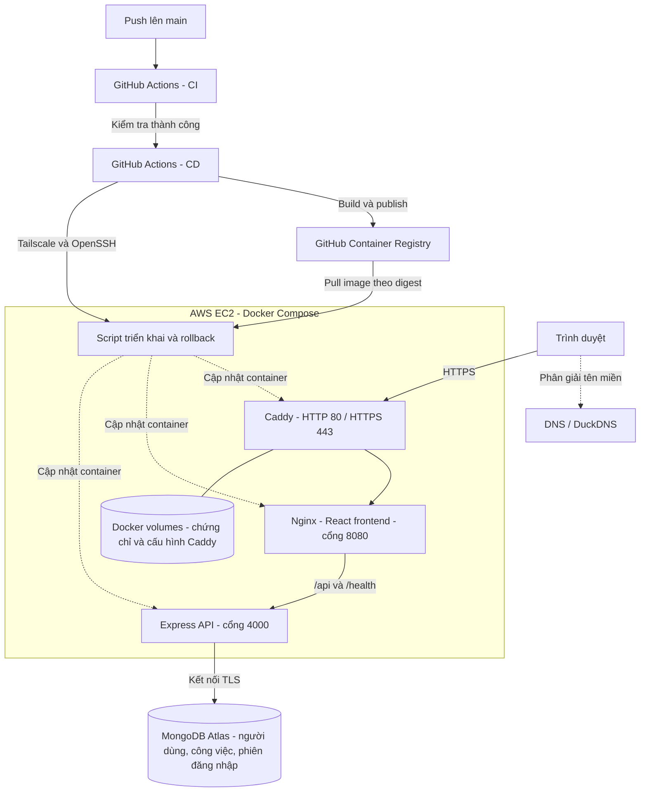

# TaskFlow Cloud

Ứng dụng web quản lý công việc cá nhân với giao diện tiếng Việt, triển khai bằng Docker Compose trên AWS EC2 và lưu dữ liệu trong MongoDB Atlas.

## 1. Mô tả project

- Đăng ký, đăng nhập, đăng xuất và duy trì phiên đăng nhập bằng cookie.
- Tạo, xem, sửa và xóa công việc; mỗi tài khoản quản lý dữ liệu riêng.
- Đặt mô tả, mức ưu tiên và thời hạn: không hạn, chỉ ngày hoặc ngày kèm giờ.
- Chọn ngày trên lịch hoặc nhập ngày bằng bàn phím; nhập giờ theo định dạng 24 tiếng.
- Tìm kiếm, lọc theo trạng thái/ưu tiên/thời hạn, sắp xếp và phân trang.
- Xem dashboard thống kê, tiến độ hoàn thành và danh sách công việc cần xử lý trước.
- Workflow v0.2 hỗ trợ ba trạng thái, tạo/sửa nhanh, hoàn tác, lịch sử hoạt động và thùng rác có thể khôi phục.

Các tính năng workflow được điều khiển bằng cờ cấu hình. Thực hiện bước nâng cấp dữ liệu ở mục 4 trước khi bật trên một database.

## 2. Sơ đồ kiến trúc



Caddy tiếp nhận truy cập công khai và cấp chứng chỉ HTTPS. Nginx phục vụ giao diện đã build, đồng thời chuyển tiếp API tới backend. Frontend và backend giao tiếp trong mạng Docker; production không công khai cổng backend hoặc chạy MongoDB trên EC2. Dữ liệu ứng dụng và phiên đăng nhập nằm trong Atlas.

Ở môi trường development, Vite thay Nginx/Caddy và Compose khởi chạy thêm MongoDB local với volume riêng.

## 3. Công nghệ và dịch vụ cloud

| Thành phần         | Công nghệ / dịch vụ                            | Vai trò                                        |
| ------------------ | ---------------------------------------------- | ---------------------------------------------- |
| Frontend           | React, TypeScript, Vite, Tailwind CSS          | Giao diện web và quá trình build               |
| Backend            | Node.js 24, Express, TypeScript                | API, xác thực và xử lý nghiệp vụ               |
| Database           | MongoDB Atlas, Mongoose                        | Lưu dữ liệu bền vững và kiểm tra schema        |
| Phiên đăng nhập    | express-session, connect-mongo                 | Lưu phiên trong MongoDB, cookie HttpOnly       |
| Đóng gói           | Docker, Docker Compose                         | Build image và vận hành các container          |
| Web server         | Nginx, Caddy                                   | Phục vụ frontend, reverse proxy và HTTPS       |
| Compute            | AWS EC2                                        | Chạy ứng dụng trên máy ảo Linux                |
| Lưu trữ máy chủ    | Amazon EBS, Docker volumes                     | Lưu dữ liệu vận hành và chứng chỉ trên EC2     |
| DNS                | DuckDNS hoặc nhà cung cấp DNS tương đương      | Trỏ tên miền tới địa chỉ công khai của EC2     |
| CI/CD và registry  | GitHub Actions, GHCR                           | Kiểm thử, publish image và triển khai tự động  |
| Kết nối triển khai | Tailscale, OpenSSH                             | Kết nối riêng từ runner tới EC2                |
| Log và giám sát    | Pino, Docker logs/stats, Amazon CloudWatch     | Theo dõi request, container và tài nguyên EC2  |
| Kiểm thử           | Vitest, Supertest, Playwright, Python unittest | Kiểm thử ứng dụng, trình duyệt và logic deploy |

## 4. Cách chạy trên máy cá nhân

### 4.1. Chuẩn bị

- Git.
- Node.js 24 và npm nếu chạy trực tiếp hoặc chạy bộ kiểm thử.
- Docker Engine/Desktop đang hoạt động và Docker Compose từ 2.24.4 nếu chạy bằng container.
- MongoDB đang chạy hoặc quyền truy cập một database Atlas nếu chạy bằng npm.
- Python 3.9 trở lên nếu kiểm thử script triển khai.

Chạy các lệnh từ thư mục gốc repository:

```bash
git clone https://github.com/TienDat-2805/TaskFlowCloud.git
cd TaskFlowCloud
```

Tạo file cấu hình local từ mẫu nếu chưa có:

```powershell
if (!(Test-Path .env)) { Copy-Item .env.example .env }
```

Trên Linux/macOS:

```bash
test -f .env || cp .env.example .env
```

Điền cấu hình riêng theo bảng ở mục 7. Dùng secret phiên ngẫu nhiên từ 32 ký tự; tài khoản database cần quyền đọc/ghi đúng database của ứng dụng. File cấu hình riêng được bỏ qua bởi Git.

### 4.2. Chạy bằng Docker Compose

```bash
docker compose -f compose.dev.yml up --build -d
docker compose -f compose.dev.yml ps
```

Mở **http://localhost:5173**, đăng ký tài khoản và bắt đầu sử dụng. Compose chạy frontend, backend và MongoDB local; dữ liệu được giữ trong volume `mongo_data`.

Cập nhật container sau khi thay đổi mã nguồn hoặc cấu hình:

```bash
docker compose -f compose.dev.yml up --build -d
```

Dừng môi trường local:

```bash
docker compose -f compose.dev.yml down
```

Lệnh `down` giữ lại volume database. Tùy chọn `--volumes` chỉ dùng khi chủ động muốn xóa dữ liệu local.

### 4.3. Chạy trực tiếp bằng npm

Cấu hình `MONGODB_URI` cho database có thể truy cập từ máy cá nhân. Dùng chế độ development, cookie cho HTTP local và `CLIENT_ORIGIN` khớp địa chỉ frontend.

```bash
npm ci
npm run db:check
npm run dev
```

Mở **http://localhost:5173**. Vite chuyển tiếp `/api` và `/health` tới backend ở cổng `4000`. Dừng ứng dụng bằng `Ctrl+C`.

Trên PowerShell, nếu `npm.ps1` bị chặn, dùng `npm.cmd` và `npx.cmd` thay cho `npm` và `npx`.

### 4.4. Bật workflow v0.2

`TASKFLOW_V02_ENABLED` và `REQUIRE_TASK_REVISION` mặc định tắt. Khi workflow tắt, ứng dụng giữ hai trạng thái cơ bản và xóa trực tiếp công việc.

Trước khi bật workflow:

1. Dừng các tác vụ ghi dữ liệu, sao lưu và thử khôi phục vào một database riêng.
2. Chạy migration ở chế độ báo cáo:

   ```bash
   npm run migrate:v02 -w backend -- --dry-run
   ```

3. Xử lý các mục `anomalies`. Thay `TEN_DATABASE` bằng đúng tên database, sau đó áp dụng:

   ```bash
   npm run migrate:v02 -w backend -- --apply --confirm-database TEN_DATABASE --backup-confirmed
   ```

4. Thêm `--allow-remote` khi áp dụng với Atlas hoặc hostname khác localhost.
5. Bật hai cờ workflow trong cấu hình riêng và khởi động lại ứng dụng.

Database mới cũng cần migration để cài TTL cho thùng rác. Cờ `--backup-confirmed` xác nhận bản sao lưu đã được kiểm chứng; script không tự tạo backup. Chỉ tắt cờ tính năng không hoàn tác migration hay khôi phục dữ liệu đã bị TTL xóa.

Với Docker development, thêm tiền tố `docker compose -f compose.dev.yml exec backend` trước các lệnh migration ở trên. Hostname `mongo` trong Compose cần cờ `--allow-remote` khi apply.

### 4.5. Dữ liệu mẫu

Cấu hình riêng `SEED_EMAIL` và `SEED_PASSWORD`. Mật khẩu mẫu cần ít nhất 12 ký tự và tối đa 72 byte UTF-8.

```bash
npm run seed
```

Hoặc khi dùng Docker development:

```bash
docker compose -f compose.dev.yml exec backend npm run seed -w backend
```

Script tạo tài khoản demo và 5 công việc mẫu; giữ nguyên mật khẩu và các công việc đã tồn tại. Đăng nhập bằng thông tin đã cấu hình riêng cho môi trường đang chạy.

## 5. Cách build Docker image

Hai Dockerfile sử dụng chung build context là thư mục gốc repository:

```bash
docker build --target production -f backend/Dockerfile -t taskflow/backend:v0.2.0 .
docker build --target production -f frontend/Dockerfile -t taskflow/frontend:v0.2.0 .
```

Backend production chạy mã JavaScript đã biên dịch bằng user `node`, lắng nghe cổng `4000`. Frontend production là Nginx chạy không có quyền root, lắng nghe cổng `8080`. Cả hai image đều có healthcheck.

Build image development và chạy thử cùng database local:

```bash
docker compose -f compose.dev.yml build
docker compose -f compose.dev.yml up -d
```

Khi dùng các image đã gắn tag riêng với `compose.prod.yml`, cấu hình `BACKEND_IMAGE` và `FRONTEND_IMAGE` trùng tên/tag đã build. Nếu không đặt hai biến này, Compose production dùng tên image local mặc định trong file Compose.

`.dockerignore` loại cấu hình riêng, dependency và file build khỏi build context. Cấu hình runtime được truyền khi chạy container.

## 6. Các bước triển khai lên cloud

Các lệnh trong mục này dành cho Linux trên EC2. Thay `app.example.com`, đường dẫn key và các tên viết hoa bằng thông tin của môi trường cần triển khai.

### 6.1. Chuẩn bị EC2, database và tên miền

1. Dùng tài khoản/quyền quản trị phù hợp, bật MFA cho tài khoản cloud và hạn chế dùng tài khoản root hằng ngày.
2. Tạo EC2 Linux, ví dụ Ubuntu 24.04. Chọn region gần người dùng và cluster Atlas; ghi lại region, cấu hình máy và lý do lựa chọn.
3. Cấu hình Security Group cho HTTP/HTTPS ở cổng `80/443`. Nếu cần SSH công khai khi thiết lập ban đầu, chỉ cho phép IP quản trị tin cậy; sau đó có thể quản trị qua Tailscale.
4. Tạo database user trong Atlas với quyền phù hợp và cho phép địa chỉ outbound của EC2 trong IP access list.
5. Tạo bản ghi DNS, chẳng hạn bằng DuckDNS, trỏ domain tới IP công khai của EC2. Kiểm tra lại DNS và IP access list nếu địa chỉ IP thay đổi.
6. Cài Git, Python 3 và [Docker Engine kèm Compose plugin](https://docs.docker.com/engine/install/ubuntu/). Tài khoản SSH dùng cho deploy phải chạy được Docker mà không cần nhập mật khẩu tương tác.
7. Cài Tailscale trên EC2 theo [hướng dẫn Linux](https://tailscale.com/docs/install/linux), đăng nhập đúng tailnet và kiểm tra thiết bị Online.

Cổng `4000`, `8080` và database không cần mở trên Security Group. Cấu hình Compose production chỉ publish `80/443`.

### 6.2. Triển khai lần đầu

Kết nối EC2 bằng key riêng:

```bash
ssh -i PATH_TO_KEY.pem LINUX_USER@EC2_HOST
```

Trên EC2:

```bash
git clone https://github.com/TienDat-2805/TaskFlowCloud.git
cd TaskFlowCloud
sudo install -d -m 700 -o "$(id -un)" -g "$(id -gn)" /opt/taskflowcloud
test -f /opt/taskflowcloud/.env.production || install -m 600 .env.example /opt/taskflowcloud/.env.production
```

Bước tạo file mẫu chỉ dùng cho môi trường mới; với máy đang vận hành, giữ file cấu hình hiện có. Điền `APP_DOMAIN`, `MONGODB_URI`, `SESSION_SECRET` và các biến cần thiết theo mục 7. `APP_DOMAIN` là hostname, không gồm giao thức hoặc đường dẫn.

Kiểm tra cấu hình mà không in giá trị ra terminal, rồi khởi chạy:

```bash
docker compose --project-name taskflow-cloud --env-file /opt/taskflowcloud/.env.production -f compose.prod.yml config --quiet
docker compose --project-name taskflow-cloud --env-file /opt/taskflowcloud/.env.production -f compose.prod.yml up --build -d
docker compose --project-name taskflow-cloud --env-file /opt/taskflowcloud/.env.production -f compose.prod.yml ps
curl -fsS https://app.example.com/health
```

Truy cập domain bằng HTTPS và kiểm tra đăng ký/đăng nhập. Caddy cấp chứng chỉ khi DNS và cổng `80/443` hoạt động đúng.

Với image production, migration và seed chạy bằng script đã biên dịch. Áp dụng quy trình sao lưu/kiểm tra ở mục 4.4 trước khi bật workflow:

```bash
docker compose --project-name taskflow-cloud --env-file /opt/taskflowcloud/.env.production -f compose.prod.yml exec backend node backend/dist/scripts/migrate-v02.js --dry-run
docker compose --project-name taskflow-cloud --env-file /opt/taskflowcloud/.env.production -f compose.prod.yml exec backend node backend/dist/scripts/migrate-v02.js --apply --confirm-database TEN_DATABASE --backup-confirmed --allow-remote
```

Sau khi bật hai cờ workflow, chạy lại lệnh `up -d` để nhận cấu hình mới. Khi đã thiết lập thông tin tài khoản mẫu, có thể tạo dữ liệu demo:

```bash
docker compose --project-name taskflow-cloud --env-file /opt/taskflowcloud/.env.production -f compose.prod.yml exec backend node backend/dist/scripts/seed.js
```

### 6.3. Ghi nhận bản đang chạy cho rollback

Trên EC2, từ checkout tương ứng với phiên bản thực sự đang chạy:

```bash
python3 infra/deploy/deploy.py adopt \
  --source "$PWD" \
  --root /opt/taskflowcloud \
  --project taskflow-cloud \
  --url https://app.example.com \
  --revision "$(git rev-parse HEAD)"
```

Chỉ thực hiện một lần khi chưa có baseline. Nếu tiếp nhận một stack đã tồn tại, dùng checkout/cấu hình và commit của bản đang chạy. `--project` phải trùng Compose project hiện có.

Script lưu image ID, cấu hình release và trạng thái vào `/opt/taskflowcloud`. Giữ các image và thư mục release đã ghi nhận để có thể rollback.

### 6.4. Cấu hình CI/CD

- [CI](.github/workflows/ci.yml) chạy khi có pull request hoặc push lên `main`: lint, format, TypeScript, kiểm thử, build, Chromium desktop/mobile và kiểm chứng Docker Compose.
- [CD](.github/workflows/cd.yml) chạy sau khi CI của một lần push lên `main` thành công. CD build lại image production cho `linux/amd64` và `linux/arm64`, publish lên GHCR rồi triển khai qua Tailscale và OpenSSH.
- Image được gắn tag theo commit; deploy dùng digest SHA-256 và kiểm tra nhãn revision của image. Các lượt deploy chạy tuần tự và bỏ qua commit không còn là đầu nhánh `main`.

Để cấu hình cho môi trường triển khai:

1. Tạo GitHub Environment `production`, giới hạn nhánh deployment là `main`; có thể yêu cầu phê duyệt trước deploy.
2. Thêm secrets và variables trong bảng ở mục 7.2.
3. Tạo OAuth client Tailscale có quyền `auth_keys` ghi và cho phép `tag:ci`. Tailnet policy cần cho runner mang tag này kết nối SSH tới EC2. Tham khảo [Tailscale GitHub Action](https://github.com/tailscale/github-action).
4. Đặt `DEPLOY_HOST` là địa chỉ Tailscale của EC2. Đồng bộ đích `ping` và địa chỉ/cổng trong bước `Verify private SSH connection` của workflow với máy chủ này.
5. Xác minh fingerprint SSH bằng kênh quản trị tin cậy rồi lưu known hosts tương ứng. Workflow bắt buộc kiểm tra host key.
6. Đảm bảo tài khoản SSH trên EC2 pull được hai image GHCR. Có thể để `CD_ENABLED` tắt và push một commit để publish image trước khi cấu hình quyền pull. Package private cần đăng nhập registry trên EC2 bằng token có quyền `read:packages`; package public có thể pull không cần đăng nhập. Xem [hướng dẫn GHCR](https://docs.github.com/en/packages/working-with-a-github-packages-registry/working-with-the-container-registry).
7. Khi baseline, HTTPS, database và kết nối riêng đã sẵn sàng, đặt repository variable `CD_ENABLED` thành `true`.

Push lên `main` để kích hoạt quy trình. Kiểm tra cả job `publish` và `deploy`; một lượt CD xanh nhưng deploy bị `Skipped` chưa xác nhận EC2 đã cập nhật.

CD pull image, cập nhật container và kiểm tra `/health`, frontend cùng API công khai. Trạng thái release chỉ được ghi sau khi kiểm tra đạt. Nếu bước cập nhật hoặc kiểm tra thất bại, script thử khôi phục bản trước; job vẫn báo lỗi để người vận hành biết.

Khi EC2 dừng để tiết kiệm chi phí, đặt `CD_ENABLED` thành `false`. Khi cần cập nhật, bật EC2, đợi Tailscale Online, bật lại cờ và chạy lại CD của commit mới nhất đã qua CI. Khởi động EC2 không tự kích hoạt lại lượt deploy đã thất bại. CD không tự bật/tắt EC2, chạy migration hoặc tạo dữ liệu mẫu.

### 6.5. Rollback

Trên EC2:

```bash
python3 /path/to/checkout/infra/deploy/deploy.py rollback \
  --root /opt/taskflowcloud \
  --project taskflow-cloud \
  --url https://app.example.com
```

Lệnh khôi phục bản trước được ghi trong `state.json`. Rollback container không hoàn tác dữ liệu database; thay đổi schema cần phương án backup/restore riêng.

## 7. Các biến môi trường cần cấu hình

### 7.1. Ứng dụng và Docker Compose

Bảng dưới chỉ mô tả tên biến và yêu cầu cấu hình. Thông tin kết nối, mật khẩu và key được cung cấp riêng cho từng môi trường.

| Biến                              | Mục đích / yêu cầu                                                    |
| --------------------------------- | --------------------------------------------------------------------- |
| `NODE_ENV`                        | Chế độ development, test hoặc production                              |
| `PORT`                            | Cổng API; cấu hình frontend và proxy cần khớp cổng này                |
| `MONGODB_URI`                     | Chuỗi kết nối tới đúng database; chứa thông tin nhạy cảm              |
| `SESSION_SECRET`                  | Secret ngẫu nhiên cho phiên đăng nhập, ít nhất 32 ký tự               |
| `CLIENT_ORIGIN`                   | Origin frontend được phép gửi yêu cầu ghi; production cần HTTPS       |
| `COOKIE_SECURE`                   | Bật với HTTPS; cấu hình local HTTP cần tắt                            |
| `TRUST_PROXY`                     | Số proxy tin cậy; Compose production có chuỗi Caddy → Nginx → Express |
| `TASKFLOW_V02_ENABLED`            | Bật workflow sau khi hoàn tất migration                               |
| `REQUIRE_TASK_REVISION`           | Yêu cầu revision khi cập nhật/xóa/khôi phục; bật cùng workflow        |
| `LOG_LEVEL`                       | Mức ghi log backend                                                   |
| `MONGODB_DNS_SERVERS`             | Tùy chọn: DNS resolver cho môi trường gặp lỗi tra cứu SRV             |
| `SEED_EMAIL`, `SEED_PASSWORD`     | Tài khoản mẫu dùng cho seed và smoke test                             |
| `APP_DOMAIN`                      | Hostname công khai của ứng dụng production                            |
| `BACKEND_IMAGE`, `FRONTEND_IMAGE` | Tên/tag hoặc digest image; CD truyền cặp digest của release           |
| `VITE_HOST`, `API_PROXY_TARGET`   | Cấu hình Vite development; Compose dev đã truyền các giá trị phù hợp  |
| `SMOKE_BASE_URL`                  | Tùy chọn: URL đích của smoke test; mặc định dùng client origin        |

Compose production tự đặt chế độ production, cổng backend, secure cookie, origin HTTPS, số proxy và mức log. Các biến được Compose cố định không thay đổi chỉ bằng cách sửa file cấu hình riêng.

### 7.2. GitHub Actions

| Tên                                     | Nơi cấu hình                          | Mục đích                                           |
| --------------------------------------- | ------------------------------------- | -------------------------------------------------- |
| `DEPLOY_HOST`                           | Secret của Environment `production`   | Hostname/IP Tailscale của EC2                      |
| `DEPLOY_USER`                           | Secret của Environment `production`   | Tài khoản Linux chạy Docker                        |
| `DEPLOY_SSH_KEY`                        | Secret của Environment `production`   | Private key OpenSSH dùng để deploy                 |
| `DEPLOY_KNOWN_HOSTS`                    | Secret của Environment `production`   | Host key đã xác minh cho máy chủ và cổng SSH       |
| `TS_OAUTH_CLIENT_ID`, `TS_OAUTH_SECRET` | Secrets của Environment `production`  | Xác thực runner vào tailnet                        |
| `DEPLOY_URL`                            | Variable của Environment `production` | HTTPS origin dùng để kiểm tra release              |
| `DEPLOY_PATH`                           | Variable của Environment `production` | Thư mục runtime và trạng thái triển khai trên EC2  |
| `DEPLOY_PROJECT`                        | Variable của Environment `production` | Tên Compose project, giữ nhất quán qua các release |
| `DEPLOY_PORT`                           | Variable của Environment `production` | Cổng OpenSSH của EC2                               |
| `CD_ENABLED`                            | Repository variable                   | Bật/tắt job deploy; phải đặt ở cấp repository      |
| `DEPLOY_RUNNER`                         | Repository variable, tùy chọn         | Nhãn runner Linux có thể kết nối tới máy chủ       |
| `GITHUB_TOKEN`                          | GitHub Actions tự cấp                 | Publish image bằng quyền `packages: write`         |

Đồng bộ các biến deploy với thư mục và Compose project đã dùng khi adopt. `DEPLOY_URL` phải khớp domain của ứng dụng trên máy chủ.

## 8. Cách kiểm thử và xem log

### 8.1. Kiểm thử tự động

Sau `npm ci`, chạy:

```bash
npm run check
npm run format:check
npx playwright install chromium
npm run e2e -w frontend
python3 -m unittest discover -s infra/deploy -p 'test_*.py'
```

Trên Windows có thể dùng `python` thay `python3`. Linux có thể cần cài dependency trình duyệt bằng `npx playwright install --with-deps chromium`.

- Backend test dùng MongoDB tạm; frontend test dùng HTTP giả lập.
- Bộ Playwright tự chạy frontend ở cổng `5174`, API ở `4011` và database tạm riêng. Các cổng này phải trống; lần chạy đầu cần mạng để tải browser/binary.
- Python unittest kiểm tra logic deploy, baseline, rollback và ghi trạng thái release.
- Ảnh chụp và báo cáo kiểm thử nằm trong `test-results/`, được bỏ qua bởi Git.

Kiểm chứng Docker với Docker daemon đang chạy:

```bash
npm run verify:compose -w backend
npm run verify:compose -w backend -- --production
```

Hai lệnh tạo môi trường test riêng để kiểm tra backup/restore, migration, phân quyền, lưu dữ liệu sau restart, health và log. Chế độ production kiểm tra image qua Nginx trên HTTP local; kiểm tra HTTPS và hạ tầng cloud được thực hiện riêng sau deploy.

Smoke test khi ứng dụng đang chạy và tài khoản mẫu đã được tạo:

```bash
npm run smoke
```

Smoke test đăng nhập, tạo/sửa/xóa một công việc tạm rồi đăng xuất. Khi chạy trên môi trường có dữ liệu thật, dùng tài khoản kiểm thử riêng. Với image production có thể chạy script `backend/dist/scripts/smoke.js` bằng Node trong container backend.

### 8.2. Kiểm tra sau triển khai

Thực hiện trên URL công khai và lưu kết quả cho phiên bản cần nghiệm thu:

| Mã  | Kiểm tra                      | Kết quả mong đợi                                                |
| --- | ----------------------------- | --------------------------------------------------------------- |
| T1  | Mở URL HTTPS                  | Giao diện hiển thị và tải được tài nguyên                       |
| T2  | Đăng ký, đăng nhập, đăng xuất | Phiên hoạt động và chỉ truy cập được dữ liệu cá nhân            |
| T3  | Thêm, sửa, xóa công việc      | Dữ liệu thay đổi đúng, kiểm tra thêm khôi phục khi bật workflow |
| T4  | Khởi động lại ứng dụng        | Tài khoản và công việc vẫn còn                                  |
| T5  | Gọi `/health`                 | HTTP 200, trạng thái ứng dụng và database sẵn sàng              |
| T6  | Gửi dữ liệu không hợp lệ      | Báo lỗi phù hợp, ứng dụng tiếp tục hoạt động                    |
| T7  | Xem log request/lỗi           | Tìm được request và mã trạng thái tương ứng                     |

`/health` trả `503` khi database không sẵn sàng. `/api/auth/me` trả `401` khi chưa đăng nhập là hành vi bình thường.

Để kiểm tra T4, dùng file Compose của release hiện tại theo mục 8.3 rồi chạy:

```bash
docker compose --project-name taskflow-cloud --env-file /opt/taskflowcloud/.env.production -f compose.prod.yml restart backend frontend
```

Sau restart, tải lại trang và kiểm tra tài khoản, công việc đã tạo vẫn còn.

### 8.3. Xem log và trạng thái

Môi trường local Docker:

```bash
docker compose -f compose.dev.yml ps
docker compose -f compose.dev.yml logs --tail=100 -f backend frontend
curl -fsS http://localhost:5173/health
```

Trên EC2, dùng file Compose của release đang chạy. Sau CD, file này nằm trong `/opt/taskflowcloud/releases/COMMIT_SHA`; thay `COMMIT_SHA` bằng revision hiện tại trong `state.json`.

```bash
cd /opt/taskflowcloud/releases/COMMIT_SHA
docker compose --project-name taskflow-cloud --env-file /opt/taskflowcloud/.env.production -f compose.prod.yml ps
docker compose --project-name taskflow-cloud --env-file /opt/taskflowcloud/.env.production -f compose.prod.yml logs --tail=100 -f backend frontend caddy
docker stats --no-stream
curl -fsS https://app.example.com/health
```

Trước khi adopt/CD, có thể chạy các lệnh tương tự từ checkout triển khai ban đầu. Dùng đúng `DEPLOY_PATH` và Compose project nếu đã đổi mặc định.

Backend ghi log JSON ra stdout với `requestId`, phương thức, đường dẫn, mã HTTP và thời gian xử lý. Khi chạy npm, log xuất hiện trực tiếp trong terminal. Log pipeline nằm trong tab Actions của repository.

### 8.4. Giám sát tài nguyên và chi phí

- Dùng `docker stats` để xem CPU, RAM và mạng của container trên EC2.
- Xem `CPUUtilization`, lưu lượng mạng và status checks trong EC2 Monitoring/CloudWatch. Basic monitoring cung cấp dữ liệu theo khoảng 5 phút; xem [metric EC2](https://docs.aws.amazon.com/AWSEC2/latest/UserGuide/viewing_metrics_with_cloudwatch.html).
- Log ứng dụng được đọc bằng Docker Compose qua SSH; repo không thiết lập tự động chuyển log tới CloudWatch Logs.
- Tạo [AWS Budget](https://docs.aws.amazon.com/cost-management/latest/userguide/budgets-create.html) với ngưỡng và người nhận thông báo phù hợp; theo dõi chi phí theo dịch vụ trong Billing/Cost Explorer.
- Ước tính một tháng dựa trên giờ chạy EC2, dung lượng EBS, IPv4, lưu lượng ra Internet, gói Atlas và các dịch vụ bổ sung. Ghi rõ region, cấu hình máy và giả định; lưu ảnh monitoring/chi phí cùng kết quả kiểm thử.

## 9. Cách xóa tài nguyên cloud

Thực hiện khi kết thúc sử dụng môi trường, sau khi đã sao lưu và kiểm tra khôi phục dữ liệu cần giữ.

1. Đặt repository variable `CD_ENABLED` thành `false` để ngăn các lần deploy tiếp theo.
2. Trên EC2, từ thư mục cấu hình của release hiện tại, dừng stack:

   ```bash
   docker compose --project-name taskflow-cloud --env-file /opt/taskflowcloud/.env.production -f compose.prod.yml down
   ```

3. Trong AWS EC2, chọn đúng instance của project và dùng **Terminate (delete) instance**. Kiểm tra thuộc tính xóa volume khi terminate; xem [hướng dẫn EC2](https://docs.aws.amazon.com/AWSEC2/latest/UserGuide/terminating-instances.html).
4. Kiểm tra và xóa EBS volume, snapshot, Elastic IP, log group hoặc tài nguyên tính phí khác của project còn lại khi không cần giữ; hủy đăng ký AMI không còn dùng. Chỉ xóa tài nguyên do môi trường này sở hữu.
5. Trong Atlas, xóa database hoặc cluster dành riêng cho môi trường sau khi có backup cần thiết. Với cluster dùng chung, chỉ gỡ dữ liệu/user/quyền truy cập thuộc ứng dụng; kiểm tra riêng chi phí cluster và backup còn lưu.
6. Gỡ thiết bị EC2 khỏi Tailscale, thu hồi OAuth client/key deploy chỉ dùng cho môi trường này và xóa secrets/variables không còn dùng trong GitHub.
7. Xóa bản ghi DNS/DuckDNS và các phiên bản image GHCR không còn cần giữ.
8. Kiểm tra lại Billing/Cost Explorer và danh sách tài nguyên ở các region đã sử dụng.

Dừng container hoặc **Stop EC2** chưa xóa hết tài nguyên có thể tính phí, chẳng hạn volume EBS hoặc Elastic IP. Tham khảo [các nguyên nhân còn phát sinh phí sau khi terminate](https://repost.aws/knowledge-center/ec2-billing-terminated).
